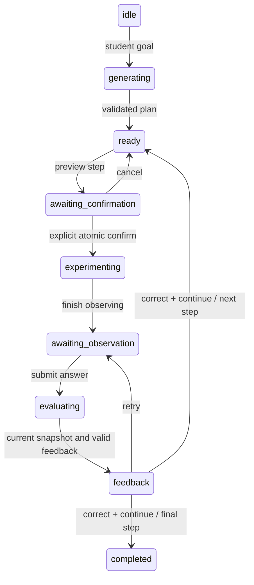

# Architecture

## Extension of Day 1

Day 2 preserves the original React/Vite/Tailwind/Zustand application and FastAPI health API. No runtime dependency was replaced. The analytical equations, fixed world coordinates, SI convention and existing physics tests remain intact.

`App` composes the simulation/control workspace, a preset/lesson learning row, live readings, a comparison table, and the original educational/AI-placeholder panels. New panels extend the existing dark theme and responsive breakpoints.

## Physics and projections

`physics.ts` owns force, acceleration, analytical particle state, trajectory sampling and vector magnitude. Validation rejects non-finite inputs, non-positive mass, negative time and overflowing results. `coordinates.ts` maps physical y-up to Canvas y-down using one scale factor. Components never recalculate force or acceleration.

## State and preset transitions

`presets.ts` defines `ExperimentPreset` (ID, title, description, learning objective, expected behavior and SI parameters). Four immutable presets represent charge sign, doubled field, and no field. Nested vector snapshots are cloned and frozen.

Zustand owns parameters, status, elapsed time, error, activePresetId, baseline, and currentLessonStepId. `applyPreset` validates and commits parameters, identity, paused status, time zero and cleared error in one `set` notification. Trajectories are analytical projections of time, so zero time clears the path without maintaining a second trajectory state. Manual edits validate, reset/pause, and clear preset identity; reset retains current identity and parameters. Baseline and lesson navigation do not change physical time or playback.

Control inputs keep only a transient text draft to support empty/negative keyboard entry. Invalid drafts display accessible errors and leave committed physical parameters unchanged. A preset or committed parameter change synchronizes drafts and clears stale validation messages. Drafts are never used by physics.

## Comparison

The baseline is a detached, deeply frozen parameter snapshot. Save replaces it explicitly; Clear removes it. `comparison.ts` derives all physical values through the engine at t=0 because force and acceleration are constant in this model. Display-unit conversions live with the pure comparison model.

Each row includes ID, label, units, scalar/component/magnitude classification, before/current values, signed delta, percentage and an explicit undefined reason. Absolute difference is the magnitude of delta. Percent is `100 * (current - baseline) / abs(baseline)`, not division by a signed baseline. Zero baselines, including zero-to-zero, have no defined relative percentage. Arithmetic overflow is represented by null, never displayed as NaN/Infinity. A ratio fallback permits a finite percentage when raw subtraction overflows; finite deltas are used directly to retain precision for nearby large values.

`ExperimentComparison` subscribes to parameter/baseline references and memoizes rows. Time ticks do not cause rerenders or alter the comparison. Presentation formats scalar differences; no physics formulas are embedded in React.

## Authored guided learning

`learning/lessons/uniformElectricField.ts` contains `GuidedLesson` and `LessonStep` data with stable IDs, objectives, explanations, conceptual questions and suggested preset IDs. The pure navigation helper clamps at the first/last step. Store navigation changes only currentLessonStepId; applying a suggestion explicitly calls the shared preset action. The lesson component has no effect that overwrites parameters on navigation.

The schema separates educational content from UI so future validated/generated content could use the same renderer. Guided lesson content remains authored. Day 3 adds a separate provider-backed tutor without changing those lesson data or navigation semantics.

## Simulation Context v1

`buildSimulationContext(input)` is pure and accepts parameters, time, optional active preset ID and optional current lesson step ID explicitly. It returns:

```ts
{
  schemaVersion: 1,
  simulationId: 'uniform-electric-field-2d',
  unitSystem: 'SI',
  parameters,
  time,
  particleState,
  force,
  acceleration,
  activePresetId: null | PresetId,
  currentLessonStepId: null | LessonStepId
}
```

The builder explicitly picks physical numeric fields and clones nested vectors, preventing accidental propagation of extra runtime properties. Derived values are calculated from one analytical state, validated for finiteness and detached from inputs. Optional IDs serialize as explicit null. Force/acceleration are repeated at top level as requested transport fields and agree with particleState when built; consumers should treat the transport snapshot as read-only.

The object includes no controls, layout, baseline, secrets or personal details. Stable simulation/step IDs let a future tutor ground explanations in the same experiment. Version and SI markers allow the backend to reject incompatible contracts. Day 3 introduces matching strict server validation and an explicit submission path. The pure builder itself performs no I/O. Only the tutor submit action sends a detached snapshot.

## Canvas lifecycle and DPR

The existing single RAF loop renders analytical state and directly advances the store without subscribing the whole React tree. Physical information polls at 100 ms. Visibility changes clear the last frame timestamp; hidden tabs do not advance. Delta is capped at 50 ms. Reset/parameter/preset changes all set t=0.

ResizeObserver and window resize synchronize CSS dimensions with DPR-scaled bitmap dimensions. A resolution media query is re-armed after every DPR change. Because Chromium's emulated DPR changes did not reliably emit resolution events during testing, RAF also compares the current DPR with the last rendered ratio; it rebuilds the bitmap only when the ratio differs. That check requires no layout read on ordinary frames. Cleanup cancels RAF, disconnects the observer, and removes visibility, resolution and resize listeners, including under StrictMode setup/cleanup.

## API and testing boundaries

FastAPI uses an organized API router, Pydantic health schema and local CORS. Its existing three tests use HTTPX ASGITransport. API health failure cannot block client-side simulations.

Vitest includes only `src/**/*.test.ts`; Playwright uses `e2e/` to avoid cross-running test frameworks. Playwright starts its own Vite server on 5174 with no server reuse. Learning tests intercept health and separately cover failure. Tests use semantic roles and bounded assertions, no arbitrary sleeps, with zero retries. Retina/DPR emulation checks bitmap dimensions; real multi-monitor and browser zoom behavior still need hardware validation.

## Day 3 backend boundaries

`schemas/ai.py` defines frozen strict models matching Context v1, with forbidden extra fields and finite numeric constraints. `context_validator.py` independently calculates analytical state and verifies all frontend-derived components and duplicated force/acceleration fields. The prompt receives the canonical server result, never an unchecked client-derived value. Relative tolerance is 1e-8 with a 1e-15 absolute floor; values outside finite range are rejected.

`config.py` reads backend-only environment values without exposing key representations. `TutorProvider` is an async protocol; `OpenAICompatibleProvider` is its single production adapter. HTTPX streams and bounds the upstream envelope, does not follow redirects or trust environment proxies, requests JSON output and bounded tokens, and validates the content into `Explanation`. Timeout, transport, upstream and malformed responses become safe domain errors. No raw provider exceptions reach the UI.

`TutorService` owns per-process fail-fast concurrency (two slots) and total deadlines, verifies context before calling the provider, assembles messages through `prompt_builder.py`, and checks output before return. A system message defines physical direction, SI conventions, question-language matching and data/instruction boundaries. The student question and context are serialized as user-role JSON data. No tools or parameter-mutation actions are exposed. Prompt rules reduce injection risk but cannot guarantee language-model behavior; deterministic readings remain authoritative.

`routes/ai.py` handles HTTP mapping and local/origin guards; `request_limits.py` bounds streamed request bytes before JSON parsing. The application sanitizes validation errors to locations/messages/types without echoing input values. Health routing remains independent of provider configuration. CORS permits POST only for configured origins. Uvicorn remains loopback-only; authenticated/budgeted access is required before any public proxy/deployment.

## Day 3 frontend lifecycle

`services/tutor.ts` captures and recursively freezes a context and question, validates structured responses, and maps known backend codes to safe messages. `AITutorPanel` associates every response with its exact request. The single in-flight controller prevents duplicate submissions and aborts on unmount; identity and abort checks prevent late state updates. Retry explicitly captures current state.

A store subscription compares time, physical parameters and educational IDs to the submitted context. A ref records the last stale flag, so ordinary animation frames do not repeatedly set React state. No physics or Canvas execution waits for the network. The UI identifies earlier snapshots and shows submitted time, preset and SI parameters. It renders escaped plain text; no HTML injection or remote links are synthesized.

## Day 3 tests

Testing Library/jsdom tests the form, loading/result/error states, immutable snapshots, stale notices, request deduplication and cleanup. Existing Vitest physics and store tests remain intact. Four additional Chromium cases cover suggestion selection, success, failure/retry and concurrent simulation changes. The obsolete Coming Soon assertion was updated to the implemented panel. Backend tests use mocked HTTP and provider dependencies; no test spends provider credit.

## Gemini environment follow-up

`app/environment.py` loads a fixed absolute backend-local .env path before CORS settings and app construction. It uses python-dotenv without variable interpolation and without overriding explicit process environment. Configuration still flows through the existing four LLM environment variables and ProviderSettings validation. Missing .env remains safe. Gemini uses the existing HTTP adapter and API/physics contracts; upstream 404 has a distinct safe model-unavailable classification. Live model-list success does not imply permission to generate with every listed legacy model.

## Completed Gemini 3.5 Flash-Lite integration

The provider still implements the original TutorProvider protocol and returns the same strict Explanation object. An internal completion-token limit can be lowered for manual smoke checks (64–1500); normal tutor requests retain the 1500 default. ProviderError now records an optional upstream HTTP status for internal diagnostics, while API responses expose only safe messages/codes. Authentication/permission errors, model availability errors and provider rate/quota errors are distinct; no raw Google error bodies are returned.

The local environment and placeholder-only example select gemini-3.5-flash-lite at Google's OpenAI-compatible endpoint. No native Google SDK, alternate context schema, billing integration or automatic model fallback was added. Real manual verification is recorded separately from mocked regression tests, and exact project quota is explicitly unverified where unavailable.

## Day 4 action planning

Flow: immutable frontend snapshot → `POST /api/ai/plan-action` → verify Context v1 against analytical physics → one bounded Gemini JSON completion → strict decision/action validation → temporary parameter copy → deterministic preview → frontend schema/physics revalidation → human confirmation → one Zustand update. There is no backend execution endpoint, persistent proposal state, arbitrary tool loop, code evaluator or generated URL navigation.

The request adds metadata without modifying Context v1:

```json
{
  "instruction": "Double the vertical electric field.",
  "simulation_context": "<existing Context v1 object>",
  "snapshot_id": "<opaque client-generated UUID>",
  "parameter_revision": 4
}
```

The context placeholder above is illustrative; the API requires the full existing object. The snapshot ID associates a response with its captured request; it is not a server signature or an authorization token. The monotonically increasing local revision detects edits, presets and resets, including edit-then-revert (ABA). Confirmation compares revision, exact captured parameter structure and preset identity inside the synchronous Zustand setter, then revalidates the action, before/after data and deterministic physics. Playback/time and lesson navigation alone do not invalidate parameter proposals: previews describe the new experiment at t=0 and confirmation always pauses/resets it. Day 3 explanations retain their stricter time/lesson staleness notice.

Each action has integer `schema_version: 1` and a discriminator `action`:

| Operation | Additional fields | Meaning |
| --- | --- | --- |
| `set_parameter` | `target`, finite SI `value` | Set one allowed parameter |
| `scale_parameter` | `target`, finite `factor` in (0,10] | Multiply one parameter, then validate the resulting value |
| `select_preset` | `preset_id` | Select one of the four existing experiments |
| `reset_simulation` | none | Retain parameters and reset time/trajectory |

Targets are existing property paths: `charge`, `mass`, `field.x`, `field.y`, `initialVelocity.x`, `initialVelocity.y`. No initial-position editing, arbitrary paths, extra fields, alternate schema versions, boolean/string numbers, NaN/Infinity, unsupported presets, confirmation overrides or silent clamping are accepted. Both runtimes read bounds/conversions from `shared/simulation-controls.json`: charge ±10 nC, mass 0.1–10 mg, field components ±500 N/C, velocity components ±10 m/s. UI step sizes guide controls, not numerical quantization of AI actions. Preset physics is checked by existing frontend engine tests and backend action tests.

The model returns only `{status: "proposal", action, explanation}` or `{status: "clarification_needed", explanation}`. Proposal responses add `before`, `after`, `before_physics`, `after_physics`, `snapshot_id`, `parameter_revision`, and server-generated `requires_confirmation: true`. Physics previews contain force, acceleration and acceleration magnitude; they are recalculated via `canonical_state`, never parsed from narrative. The frontend independently uses `calculateParticleState`. Vector values, mass, charge, initial position and initial velocity are shown with units; no division by a zero baseline is needed.

The planner prompt requires clarification for unspecified amounts, multiple changes, unsupported actions or ambiguous axes. An additional deterministic English/Chinese axis guard catches field instructions with no explicit component when both/neither component is nonzero (preset/experiment selections are excluded). Natural-language interpretation remains model-dependent; confirmation and hard bounds are mandatory even for plausible output. User/model text is rendered as text, never HTML or executable instructions. Generated language can occasionally differ from the input language.

Both tutor routes share loopback/origin guards, the 64 KiB request limit, two per-process concurrent provider slots, configured deadline, 32 KiB upstream response limit, no redirects/retries, strict JSON schemas and safe error mapping. Keys remain server-only in ignored `backend/.env`. CI uses only mocked providers and requires no credentials. The local-only protection is not authentication for a public reverse proxy. Future public deployment needs authenticated users and deployment-wide quotas; future multi-action planning needs a separately designed transaction/confirmation contract.

## Day 5 guided learning

The existing provider adapter now supports bounded lesson generation and observation evaluation, sharing local/origin guards, 64 KiB body limit, timeout and the two-request admission gate with standalone tutoring. Lesson completions have a fixed 3500-token budget; other requests retain the 1500 default. Upstream bodies remain bounded to 32 KiB. No provider calls occur in CI, and no automatic retries or tool loops were added.

`LessonDraft` is strictly versioned, with unique ordered step-1…step-5 identifiers, 1–5 steps (three by default), 1–3 Day 4 actions per step, objectives/questions/concepts/explanation and a fixed submit-observation completion criterion. Generation adds a server UUID, initial parameters, per-step before/after and authoritative predictions, required confirmation, provider model and UTC generation timestamp. Unsupported goals return a discriminated unsupported-capability response. The capability manifest restricts the existing simulation ID, operation names and parameter paths; no other experiment is invented.

Sequential validation starts from the verified request parameters. Each action is applied to a temporary copy using Day 4 validation and shared bounds, then each step inherits the previous step's final state. Duplicate parameter writes, preset selection after other writes, reset mixed with other actions, invalid intermediate states and excessive limits are rejected. Predictions use the existing canonical physics, not narrative. The browser independently reconstructs and verifies the entire chain with its existing action and physics functions. Observation requests carry the plan, step ID, answer, preferred language and a current verified context; the backend reconstructs the chain and requires current parameters to match the selected step before evaluating.

The discriminated learning state machine is:



Failures enter error, from which explicit recovery returns to ready (requiring a new setup preview) or idle. Exit enters cancelled without changing simulation state. Earlier-step navigation/restart returns to ready and never silently restores parameters. Generation/evaluation tokens and AbortController cleanup reject late asynchronous work. Parameter revision checks reject stale/ABA previews and feedback; playback time alone does not invalidate a parameter-based setup. Returning to a previous step recomputes its target from the entire validated plan, displays actual-current versus target values and requires confirmation. Both Day 4 and Day 5 commit through the same atomic Zustand commit shape and share the same preview component; no new simulation engine/control channel exists. All step actions validate before a single parameter update.

Feedback is structured as correct/partially_correct/incorrect/needs_clarification, supporting explanation, optional hint and retry/continue. Only correct + continue unlocks the next step. The verified physics remains separate from LLM narrative. Progress records completed observations, not inferred mastery.

A session-scoped zh-CN/en preference is shared by tutoring, action planning and lesson generation. Optional preference fields preserve older tutor callers; new UI requests always supply one. Every natural-language lesson/feedback field is checked for Chinese script in zh-CN (and untranslated long English words are rejected, except existing parameter identifiers), or absence of Chinese script in en. Equations/SI symbols remain untouched. A mismatch returns safe 502 language_mismatch with a manual retry/change-language fallback; no hidden translation or repeated paid calls. This script check is deliberately conservative and is not proof of semantic correctness or perfect language identification. Existing lessons keep their generated language until the student exits and generates a replacement.

Only one active lesson lives in the browser app's Zustand memory; mode navigation retains it. Cross-refresh persistence is deferred: restoring a serialized lesson, answers, simulation snapshot and in-flight status needs a separately versioned, independently revalidated restoration transaction. No credentials, prompts, provider bodies or answers are written to browser storage. Public deployment still needs authentication and global quota accounting. Future experiment support should register typed capability-specific action validators/physics and preserve this transaction/confirmation boundary.

## Registered multi-experiment platform (Day 6–7)

`ExperimentPlugin<P,S,O,Q>` defines parameter validation, initial state and evaluation with an experiment-specific query. It does not require charge, force, time or a trajectory. The registered JSON boundary uses objects for parameters/query/state/observables; a backend static scalar test and a frontend static-model scaffold demonstrate nonparticle/non-time evaluation. Current particle runtime/presentation adapters supply clocks and Canvas animation separately; a future static plugin can provide its own presentation/runtime binding without changing shared AI science orchestration.

The canonical `shared/experiments.json` declares identity/version, metadata, parameter paths/bounds/display units, operations, observables, presets, renderer ID, initial query, evolution constraints, equations, lesson capabilities and limitations. Frontend/backend import the same file; explicit registries instantiate only known plugins, never user-controlled imports. Shared cross-runtime context fixtures verify both implementations and snapshot fingerprints, and electric presets are checked against the old preset definitions. Manifest drift requires failing tests rather than invisible UI/API differences.

Context v2 is deeply immutable on both backend and frontend (normal JSON serialization produces independent data copies). It contains schema_version=2, experiment_id/version, validated parameters/query, independently recomputed simulation_state and observables, monotonic revision, and deterministic snapshot_id. Fingerprints sort keys, encode finite input numbers as exact big-endian IEEE-754 binary64 bits (zero normalized), encode UTF-8 and use FNV-1a 32-bit. Only experiment identity/version, parameters, query and revision participate in the hash; derived outputs are checked independently with numerical tolerance, preventing cross-runtime rounding from changing identity. It is correlation metadata, not a cryptographic signature. Revision plus actual parameter/experiment checks protect confirmation; disposed runtimes and switch-away/back snapshots cannot apply. No security decision relies on hash collision resistance. Unknown identities/versions, mismatched derived state or fingerprint are rejected.

The default workbench uses one experiment-independent `/api/v2/ai/{operation}` orchestration and one frontend AI component for explain, plan-action, generate-lesson and evaluate-observation. Prompts receive the selected server manifest and verified observables, never a client-invented capability set. Actions reuse the Day 4 discriminated operation schemas with selected-registry target/preset validation. Before previews use the captured current observables, while after previews explicitly describe reset/initial-query parameters. Time advancement alone does not invalidate parameter-based reset proposals: the UI labels submitted-snapshot readings and explicitly notices query changes; parameter/revision/experiment changes do invalidate them. Lessons carry experiment ID/version and reconstruct sequentially; navigation restores a validated target only after a new confirmation. Feedback validates the plan and current experiment; it cannot change scientific state or certify mastery. Displayed equations are drawn from the canonical registry; AI prose remains advisory.

The electric engine delegates to existing analytical equations; its presentation/runtime adapters reuse the original store, Canvas, controls, presets, lesson and comparison. The v1 UI is lazy-isolated at `?context=v1`, so merely loading it cannot initialize a v2 clock or impose v2 duration bounds. Original v1 APIs and tests remain intact. Migration E2E tests exercise the explicit old URL plus new default-workbench scenarios, rather than weakening or removing historical assertions.

The Lorentz engine uses a centered Boris/Cayley velocity update and trapezoidal position at fixed parameter timestep, independent of frame partition. RAF advances a bounded accumulator (frame duration capped at 50 ms, speed ≤2×, ≤1000 substeps per frame); hidden-tab intervals are discarded. Numerical state is incremental, while independent context verification recalculates from initial state under a 100000-step limit. Trace memory is capped at 2000 points; clearing it does not alter physics. DPR is observed per frame, ResizeObserver tracks geometry, and spatial scaling is isotropic. Engine errors pause the run and surface an error.

Switching policy is discard-and-default: pause/dispose old runtime, cancel/unmount requests, clear baseline/lesson/proposals, create the chosen runtime and increment globally monotonic revision identities. Language preference stays shared. No local recovery/storage was added: restoring numerical state and experiment-version-specific lesson/session identities would need a separately reviewed, versioned revalidation/confirmation transaction. The local-only authentication and per-process quota limitations still apply.

Language checks allow exact registered technical identifiers/terms, not arbitrary English prose. Prompts require localizing manifest labels/concepts and using plain-text math rather than copying English capability prose/LaTex commands. Mismatches fail clearly without automatic model retries; development-time manual retries and their initial failures are documented in the daily log.

## Unified workspace / prescribed spatial fields (2026-10-15)

The three particle experiments now share a scoped scientific-instrument layout, camera-aware Canvas, toolbar, parameter/preset presentation, metrics, bilingual educational structure and the existing PlatformAI workflow. Explicit `workspace/presentations.tsx` bindings choose Canvas and optional domain Inspector; generic scientific contracts do not require rectangular regions or particle rendering. Uniform electric/Lorentz engines and v1 classic APIs/UI are retained. Domain-specific `multi-zone-em` v1 adds strict region arrays, deterministic superposition and bounded boundary-aware integration. Region action schemas/handlers live separately, advertised by the canonical manifest and routed through existing validation/confirmation/lesson sequencing. `close` now handles JSON arrays recursively for region contexts.

Zustand owns validated physical parameters/revision and camera/visibility separately. Canvas reads the vanilla runtime in RAF; controls only subscribe to parameters, metrics update at 5 Hz plus revision/status changes, AI clock indicators at 2 Hz. Drag preview is private transient state; one atomic parameter commit pauses/resets. Bounded local storage restores only validated educational configuration, paused at t=0. It cannot restore proposal authority or bypass confirmation. See [spatial field guide](spatial-field-experiment-guide.md) for schema, camera transforms, numerical/error/work bounds, persistence version policy and extension steps.

## Governed provider boundary

Every current real completion goes through OpenAICompatibleProvider._complete → governance.gateway → admitted _request. Request middleware supplies signed session/network identity in a ContextVar; scope/result validation and token/timeout bounds are centralized. Atomic Redis Lua reservations cover global multi-instance usage; lock-protected memory is development-only. All experiments inherit this without experiment-specific AI branching. Structured action/lesson science and human confirmation remain independent authorization boundaries. Scope policy appends the actual task's Pydantic JSON Schema to prevent a model from replacing required result fields with a generic prose object. See docs/ai/guardrails.md for all limits, safe errors, limitations and deployment configuration.

## Independent analytical and event-count domains

A generic `scientificRuntime` accepts explicit clock axis/rate/horizon callbacks; optics uses a bounded detection count, not a charged-particle time/state. ScientificCanvas is a shared DPR/camera/RAF surface with specialized draw/bounds bindings; optical geometry/profile rendering is separate from EM region editing. Compact query/state/observables still use Context v2 and the same governed AI workflow. Scientific outputs are not rounded; inclusive unit-limit comparisons tolerate only relative machine epsilon in SI conversion.

Kepler adds an independent analytical two-body plugin, a period-scaled clock callback and specialized Canvas/Inspector. The relative scientific state remains SI; camera coordinates are explicitly AU. ScientificCanvas auto-fits fresh domains once, while a validated restored camera is retained. The shared AI policy/action/lesson code is unchanged. An all-domain integration test sends every registered experiment through the same actual governed adapter with mocked upstream responses, checking quota/scope/tampered context.

Momentum collisions register an independent bounded single-event engine and specialized ScientificCanvas/Inspector.1D uses exact post velocities;2D uses stable time-of-impact and frictionless normal impulse. No EM integration is reused. Lab/COM quantities are explicit; state stores one bounded event. Six plugins share existing v2/context/AI contracts. Regression tests send all four ASGI AI operations for each registered domain through the actual guarded provider with only network mocked.
